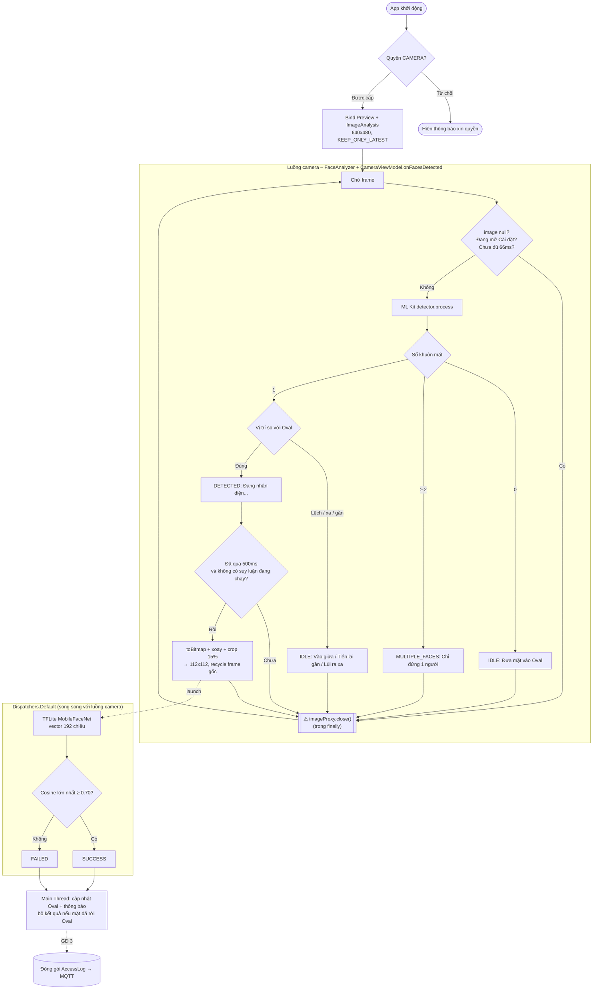

# 🔄 Activity Diagram - Luồng Xử lý Frame Camera
**Mục tiêu:** Mô tả vòng lặp xử lý 1 frame ảnh từ CameraX → ML Kit → TFLite, nhấn mạnh bước giải phóng bộ nhớ (`imageProxy.close()`).
**Cập nhật:** 07/11/2026 — khớp với mã nguồn sau GĐ 2 (`FaceAnalyzer.kt`, `CameraViewModel.kt`).

---

## Lưu đồ Thuật toán



**Đọc sơ đồ:** nhánh suy luận TFLite chạy **song song** trên luồng nền với vòng lặp camera. Frame đã được crop thành Bitmap riêng nên `imageProxy` được đóng ngay, CameraX gửi frame tiếp mà không phải chờ TFLite.

## Giải thích Chi tiết

### Tại sao `imageProxy.close()` là điểm sống còn?

| Nếu QUÊN gọi `close()` | Nếu LUÔN gọi `close()` |
|---|---|
| CameraX ngừng gửi frame mới | Frame mới được gửi liên tục |
| Buffer ảnh bị giữ trong RAM | RAM được giải phóng ngay |
| App đóng băng sau 2-3 giây | App chạy ổn định hàng giờ |
| OOM crash trên thiết bị 1GB RAM | Đảm bảo ràng buộc RAM < 1GB |

### Nguyên tắc vàng
> `imageProxy.close()` phải được gọi trong **MỌI nhánh** của luồng xử lý:
> thành công, thất bại, exception, không tìm thấy mặt, image == null, frame bị bỏ qua.
>
> Trong code: frame bị bỏ qua → `close()` ngay đầu `analyze()`; còn lại → `close()` trong khối
> `finally` của `addOnCompleteListener`, **sau khi** `onFacesDetected()` đã chuyển ảnh sang Bitmap.

### Ba tầng giới hạn tải CPU

| Tầng | Vị trí | Giới hạn |
|---|---|---|
| CameraX | `STRATEGY_KEEP_ONLY_LATEST` | Bỏ frame cũ nếu xử lý chưa kịp |
| ML Kit | `FaceAnalyzer.minIntervalMs = 66` | ≤ ~15 lần/giây; tạm dừng khi mở Cài đặt |
| TFLite | `CameraViewModel` (500ms + `AtomicBoolean`) | ≤ 2 lần/giây, không chạy chồng |

### Cấu hình CameraX thực tế (`CameraPreview.kt`)
```kotlin
val resolutionSelector = ResolutionSelector.Builder()
    .setAspectRatioStrategy(AspectRatioStrategy.RATIO_4_3_FALLBACK_AUTO_STRATEGY)
    .setResolutionStrategy(ResolutionStrategy(Size(640, 480),
        ResolutionStrategy.FALLBACK_RULE_CLOSEST_LOWER_THEN_HIGHER))
    .build()

ImageAnalysis.Builder()
    .setResolutionSelector(resolutionSelector)                       // cùng selector với Preview
    .setBackpressureStrategy(ImageAnalysis.STRATEGY_KEEP_ONLY_LATEST) // drop frame cũ
    .build()
```
(`setTargetResolution()` đã bị CameraX 1.3+ đánh dấu deprecated nên không dùng.)
