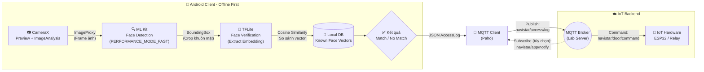

# 📐 System Architecture Diagram
**Dự án:** Hệ thống Giám sát Ra vào IoT - Lab Navistar, ĐH Bách Khoa

---

## Sơ đồ Kiến trúc Tổng thể



## Luồng Dữ liệu Chính

| Bước | Thành phần | Hành động | Dữ liệu |
|------|-----------|-----------|----------|
| 1 | CameraX | Capture frame real-time | `ImageProxy` (YUV_420_888) |
| 2 | ML Kit | Phát hiện khuôn mặt | `List<Face>` + `BoundingBox` |
| 3 | TFLite | Trích xuất vector đặc trưng | `FloatArray` (128/512-d) |
| 4 | Local DB | So sánh Cosine Similarity | `confidence: Float` |
| 5 | MQTT Client | Publish kết quả | `AccessLog` (JSON) |
| 6 | Broker → Hardware | Ra lệnh mở/đóng cửa | MQTT Command |

## Định dạng AccessLog (Đề xuất)

```json
{
  "person_id": "BK_2024_001",
  "person_name": "Nguyen Van A",
  "timestamp": "2026-09-27T08:30:00+07:00",
  "confidence": 0.95,
  "status": "AUTHORIZED",
  "device_id": "NAVISTAR_CLIENT_01"
}
```

## Câu hỏi cần chốt với Giáo viên Hướng dẫn

- [ ] App chỉ **Publish** kết quả, hay cũng phải **Subscribe** nhận lệnh phản hồi?
- [ ] Format JSON `AccessLog` gồm những trường nào?
- [ ] Topic MQTT do Lab quy định hay sinh viên tự đặt?
- [ ] Model TFLite sử dụng model nào? (MobileFaceNet / ArcFace / FaceNet?)
