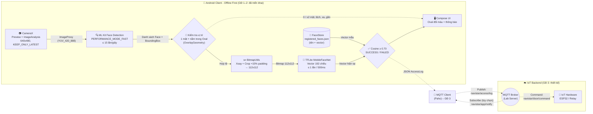

# 📐 System Architecture Diagram
**Dự án:** Hệ thống Giám sát Ra vào IoT - Lab Navistar, ĐH Bách Khoa
**Cập nhật:** 07/11/2026 — khớp với mã nguồn sau GĐ 2. Khối MQTT/IoT Backend là thiết kế cho GĐ 3 (chưa triển khai).

---

## Sơ đồ Kiến trúc Tổng thể



> Nét liền: đã có trong code. Nét đứt: thiết kế cho GĐ 3.

## Luồng Dữ liệu Chính

| Bước | Thành phần (file) | Hành động | Dữ liệu | Trạng thái |
|------|-----------|-----------|----------|:---:|
| 1 | CameraX (`ui/CameraPreview.kt`) | Lấy frame real-time 640x480, bỏ frame cũ | `ImageProxy` (YUV_420_888) | ✅ |
| 2 | ML Kit (`model/FaceAnalyzer.kt`) | Phát hiện khuôn mặt, tối đa ~15 lần/giây | `List<Face>` + `BoundingBox` | ✅ |
| 3 | `utils/OverlayGeometry.kt` | Đúng 1 mặt, tâm trong 60% bán kính Oval, cao 45–140% Oval | `Placement` (OK / OFF_CENTER / TOO_FAR / TOO_CLOSE) | ✅ |
| 4 | `utils/BitmapUtils.kt` | Xoay, crop +15% padding, resize | `Bitmap` 112x112 | ✅ |
| 5 | TFLite (`model/TFLiteFaceRecognizer.kt`) | Chuẩn hoá [-1,1], trích xuất đặc trưng (≤ 1 lần / 500ms) | `FloatArray` **192 chiều** | ✅ |
| 6 | So khớp + `data/FaceStore.kt` | Cosine Similarity với mọi người đã đăng ký, ngưỡng 0.70 | `FaceAuthResult` (status, userId, confidence) | ✅ |
| 7 | MQTT Client (GĐ 3) | Publish kết quả | `AccessLog` (JSON) | ⏳ |
| 8 | Broker → Hardware (GĐ 3) | Ra lệnh mở/đóng cửa | MQTT Command | ⏳ |

## Lưu trữ cục bộ

| Dữ liệu | Nơi lưu | Ghi chú |
|---|---|---|
| Người dùng đã đăng ký | `filesDir/registered_faces.json` (`AtomicFile`) | Chỉ tên + id + vector 192 chiều, **không lưu ảnh**; loại khỏi Auto Backup |
| Model | `assets/mobilefacenet.tflite` (~5 MB) | Nạp bằng Memory Mapping |

Ví dụ 1 bản ghi:
```json
{ "id": "USER_3F9A1C2B", "name": "Nguyen Van A", "embedding": [0.0123, -0.0456, "... 192 số"] }
```

## Định dạng AccessLog (Đề xuất cho GĐ 3 — chờ chốt với GVHD)

```json
{
  "device_id": "NAVISTAR_DOOR_01",
  "person_id": "USER_3F9A1C2B",
  "person_name": "Nguyen Van A",
  "confidence": 0.95,
  "status": "AUTHORIZED",
  "timestamp": 1730000000
}
```
* `person_id` dùng đúng mã trong `FaceStore` (`USER_` + 8 ký tự UUID).
* `status`: `AUTHORIZED` (≥ ngưỡng) hoặc `DENIED` (người lạ).
* `timestamp`: đang thống nhất theo kế hoạch là **epoch giây (UTC)**; nếu Lab cần ISO-8601 (`2026-09-27T08:30:00+07:00`) thì đổi ở GĐ 3.

## Câu hỏi cần chốt với Giáo viên Hướng dẫn

- [ ] App chỉ **Publish** kết quả, hay cũng phải **Subscribe** nhận lệnh phản hồi?
- [ ] Ai ra lệnh mở cửa: app gửi thẳng `navistar/door/command`, hay Server nhận log rồi tự quyết định?
- [ ] Format JSON `AccessLog` gồm những trường nào? `timestamp` dạng epoch hay ISO-8601?
- [ ] Topic MQTT do Lab quy định hay sinh viên tự đặt? Broker có username/password, TLS không?
- [x] Model TFLite sử dụng model nào? → **MobileFaceNet**, đầu vào 112x112x3, đầu ra vector 192 chiều, ngưỡng Cosine 0.70.
