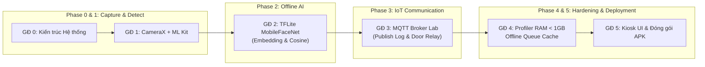

# 📋 KẾ HOẠCH TRIỂN KHAI TỔNG THỂ DỰ ÁN (PROJECT ROADMAP)

**Dự án:** Hệ thống Giám sát & Kiểm soát Ra vào IoT (Navistar Access Client)  
**Đơn vị:** Lab Navistar – Trường Công nghệ Thông tin & Truyền thông (ĐH Bách Khoa Hà Nội)  
**Phạm vi:** Đồ án môn học 2 (GR2) / Thực tập Công nghiệp (IT4948)  
**Đối tượng phần cứng mục tiêu:** Thiết bị IoT / Android Tablet gắn tường cố định, **RAM < 1GB**, hệ điều hành **Android 10.0 (API 29)**, màn hình ngang (**Landscape**), hoạt động **Offline-First**.

---

## 🗺️ TỔNG QUAN LỘ TRÌNH CÁC GIAI ĐOẠN

| Giai đoạn | Tên Giai Đoạn | Mục Tiêu Chính | Công Nghệ Cốt Lõi | Trạng Thái |
| :---: | :--- | :--- | :--- | :---: |
| **Giai đoạn 0** | **Thiết kế Kiến trúc & Báo cáo Sơ bộ** | Chốt kiến trúc hệ thống, sơ đồ luồng dữ liệu, phân tích ràng buộc RAM < 1GB | Mermaid, Markdown, MVVM Architecture | ✅ **Hoàn thành** |
| **Giai đoạn 1** | **CameraX & Nhận diện Khuôn mặt Cơ bản** | Luồng camera real-time, phát hiện mặt bằng ML Kit, vẽ Bounding Box bù tỷ lệ màn hình | CameraX, ML Kit Face Detection, Compose Canvas | ✅ **Hoàn thành** |
| **Giai đoạn 2** | **Xác thực Khuôn mặt Offline 1:1 (AI Edge)** | Crop mặt 112x112, trích xuất vector đặc trưng bằng TFLite, so khớp Cosine, Guiding UI, Throttling chống ANR | TensorFlow Lite, MobileFaceNet, Interface-driven, Compose | ✅ **Hoàn thành** |
| **Giai đoạn 3** | **Tích hợp Giao tiếp IoT qua MQTT** | Kết nối Broker nội bộ Lab, publish AccessLog JSON, nhận lệnh phản hồi điều khiển cửa | Eclipse Paho MQTT, Coroutines, JSON Serialization | ⏳ **Sẵn sàng triển khai** |
| **Giai đoạn 4** | **Tối ưu Hiệu năng, Bộ nhớ & Chống Chịu Lỗi** | Giữ RAM < 150MB, FPS ổn định, hàng đợi log offline khi mất Wi-Fi, chạy bền bỉ 24/7 | Android Profiler, Room / Cache Queue, Coroutines | 📅 **Kế hoạch** |
| **Giai đoạn 5** | **Hoàn thiện Kiosk UI, Đóng gói & Báo cáo** | Màn hình Kiosk toàn màn hình, đóng gói APK Release, nghiệm thu thực tế tại cửa Lab | ProGuard / R8, Kiosk Mode, Final Report | 📅 **Kế hoạch** |

---

## 📌 CHI TIẾT TỪNG GIAI ĐOẠN



---

### GIAI ĐOẠN 0: THIẾT KẾ KIẾN TRÚC & CHUẨN HÓA STACK CÔNG NGHỆ
> **Mục tiêu:** Định hình kiến trúc phần mềm chuẩn Clean Architecture / MVVM, giải quyết bài toán phần cứng yếu trước khi viết code.

* **Nội dung công việc đã thực hiện:**
  1. **Khảo sát ràng buộc hệ thống:** Thiết bị IoT chạy Android 10 (API 29) với RAM khả dụng rất thấp (< 1GB).
  2. **Thiết lập System Architecture (`docs/diagrams/system_architecture.md`):** Tách biệt 2 khối rõ ràng:
     * *Android Client (Offline First):* Tự xử lý phát hiện mặt, crop ảnh, trích xuất đặc trưng và so khớp hoàn toàn trên máy mà không cần gửi ảnh lên Cloud.
     * *IoT Backend:* Giao tiếp phi tập trung qua MQTT Broker với ESP32 / Relay mở cửa.
  3. **Thiết lập Activity Diagram (`docs/diagrams/activity_diagram.md`):** Chuẩn hóa chu trình sống của `ImageProxy`. Xác định điểm nút sống còn: gọi lệnh `imageProxy.close()` trong `addOnCompleteListener` để không bao giờ rò rỉ RAM.
  4. **Chuyển dịch công nghệ UI:** Nâng cấp từ XML truyền thống sang **Jetpack Compose**, tận dụng `AndroidView` cho CameraX và `Canvas` Composable để vẽ Bounding Box.

---

### GIAI ĐOẠN 1: TÍCH HỢP CAMERAX & PHÁT HIỆN KHUÔN MẶT REAL-TIME
> **Mục tiêu:** Mở luồng camera mượt mà, phát hiện khuôn mặt thời gian thực và vẽ Bounding Box chuẩn xác.

* **Nội dung công việc đã thực hiện:**
  1. **Quản lý quyền truy cập:** Tích hợp `ActivityResultContracts.RequestPermission()` cho quyền `CAMERA` theo chuẩn Compose.
  2. **Bộ thu hình CameraX (`CameraPreview.kt`):**
     * Kết hợp `PreviewView` và `ImageAnalysis` trong một cấu trúc vòng đời đồng bộ (`ProcessCameraProvider`).
     * Sử dụng chiến lược `STRATEGY_KEEP_ONLY_LATEST` để tự động bỏ khung hình cũ, tránh dồn ứ hàng đợi gây tràn bộ nhớ.
  3. **Bộ phát hiện khuôn mặt ML Kit (`FaceAnalyzer.kt`):**
     * Cấu hình chế độ siêu nhẹ: `PERFORMANCE_MODE_FAST`, tắt Landmark và tắt Phân loại (`LANDMARK_MODE_NONE`, `CLASSIFICATION_MODE_NONE`).
     * Tự động nhận diện góc xoay của cảm biến camera (`rotationDegrees` 0°, 90°, 180°, 270°) để đảo đúng chiều dài/rộng.
     * Đóng `imageProxy.close()` đảm bảo dọn dẹp bộ nhớ đệm sau mỗi frame.
  4. **Thuật toán ánh xạ tọa độ màn hình (`FaceOverlay.kt`):**
     * Xử lý độ lệch tỉ lệ do cơ chế `ScaleType.FILL_CENTER` (cắt viền ảnh thừa) của màn hình điện thoại/máy tính bảng.
     * Tích hợp phép biến đổi hình học Lật gương (`Mirror`) cho Camera trước.
  5. **Quản lý trạng thái (`CameraViewModel.kt`):** Tách riêng trạng thái ra khỏi giao diện, đảm bảo xoay màn hình không bị giật lag hay khởi động lại camera.

---

### GIAI ĐOẠN 2: XÁC THỰC KHUÔN MẶT OFFLINE 1:1 VỚI TENSORFLOW LITE
> **Mục tiêu:** Trích xuất vector đặc trưng khuôn mặt (Embeddings) và so khớp Cosine Similarity cục bộ, kết hợp giao diện hướng dẫn người dùng và tối ưu chống treo app (ANR).

* **Nội dung công việc đã thực hiện:**
  1. **Kiến trúc Interface-driven (`FaceRecognizer.kt`):** Trừu tượng hóa hoàn toàn tầng AI. Giao diện UI chỉ làm việc với Interface, sẵn sàng thay thế bằng SDK của Lab hoặc MediaPipe sau này mà không phải sửa lại code giao diện.
  2. **Pipeline Xử lý & Cắt ảnh (`BitmapUtils.kt`):**
     * Chuyển đổi khung hình từ `ImageProxy` (định dạng YUV_420_888) sang `Bitmap` đúng chiều xoay.
     * Cắt khuôn mặt theo Bounding Box của ML Kit, bổ sung **15% padding** quanh viền để không bị mất cằm, trán hoặc tai.
     * Resize chuẩn về kích thước `112x112 px` (chuẩn đầu vào của MobileFaceNet).
  3. **Mô hình TFLite & So khớp Cosine (`TFLiteFaceRecognizer.kt`):**
     * Nạp model `mobilefacenet.tflite` qua Memory Mapping (`MappedByteBuffer`) giúp tiết kiệm RAM tối đa.
     * Chuẩn hóa pixel ảnh về đoạn `[-1.0, 1.0]`.
     * Trích xuất vector đặc trưng 192 chiều và tính toán độ tương đồng **Cosine Similarity**:
       $$\text{Cosine Similarity} = \frac{\mathbf{A} \cdot \mathbf{B}}{\|\mathbf{A}\| \|\mathbf{B}\|}$$
     * Tự động phân loại: $\ge 0.70$ (Xác thực thành công), $< 0.70$ (Người lạ).
  4. **Nâng cấp UI Overlay & Lọc 1 mặt duy nhất:**
     * Thêm **Khung định vị Guiding Oval** căn giữa màn hình (đổi màu theo trạng thái: Xanh lá, Đỏ, Cam, Xanh dương).
     * Áp dụng luật **Single Face Selection**: Khi phát hiện $\ge 2$ mặt, app chỉ chọn khuôn mặt to nhất/chính diện nhất hoặc đưa ra cảnh báo nhắc nhở chỉ đứng 1 người.
  5. **Màn hình Cài đặt & Đăng ký khuôn mặt mẫu:** Thêm Dialog Cài đặt cho phép nhập tên và lưu trực tiếp vector khuôn mặt vào bộ nhớ để kiểm thử nhận diện ngay lập tức.
  6. **Tối ưu hóa Throttling & Khắc phục triệt để lỗi ANR / Chớp nháy Camera:**
     * Giới hạn tần suất suy luận AI tối đa **500ms/lần** (tránh quá tải CPU).
     * Giải phóng `Bitmap.recycle()` ngay sau khi xử lý để chống gián đoạn bởi Garbage Collector.
     * Tạm dừng AI khi mở hộp thoại Cài đặt để bàn phím ảo phản hồi mượt mà.
     * Khóa màn hình xoay ngang (`landscape`) chuẩn theo thiết bị kiểm soát cửa tại Lab.
  7. **Bản sửa lỗi ổn định & UX (05/11/2026):**
     * Khắc phục ANR khi mở Cài đặt: tạm dừng ML Kit, mọi cập nhật State đưa về Main Thread, Overlay chỉ vẽ lại ở pha draw; đăng ký mặt chạy nền.
     * Cố định độ phân giải camera 640x480 (4:3) cho Preview & Analysis; CameraX `1.4.2` ổn định; dọn dẹp camera/ML Kit đúng thứ tự khi thoát.
     * Giảm RAM: bỏ `material-icons-extended`, `tensorflow-lite-support`, `mlModelBinding`; tái sử dụng buffer TFLite; recycle Bitmap trung gian.
     * Oval có hiệu lực thật: chỉ nhận diện khi mặt nằm giữa Oval và đủ gần (`utils/OverlayGeometry.kt`), hướng dẫn "tiến lại gần / lùi ra xa", trạng thái `DETECTED` ("Đang nhận diện...").
     * Bounding box ML Kit chỉ hiện khi bật "Hiển thị khung debug" trong Cài đặt.
  * **Hạn chế còn lại:** chưa lưu người dùng đăng ký xuống bộ nhớ trong (mất khi tắt app); chưa có chống giả mạo bằng ảnh (liveness).

---

### GIAI ĐOẠN 3: TÍCH HỢP GIAO TIẾP IOT QUA MQTT BROKER
> **Mục tiêu:** Đóng gói kết quả xác thực khuôn mặt thành bản tin JSON và giao tiếp hai chiều với Broker nội bộ của Lab Navistar để kích hoạt khóa cửa điện tử.

* **Nội dung công việc cần triển khai:**
  1. **Xây dựng Data Contract (`model/AccessLog.kt`):**
     ```json
     {
       "device_id": "NAVISTAR_DOOR_01",
       "person_id": "USER_1024",
       "person_name": "Nguyen Van A",
       "confidence": 0.88,
       "status": "AUTHORIZED",
       "timestamp": 1730000000
     }
     ```
  2. **Module Kết nối MQTT (`network/MqttManager.kt`):**
     * Tích hợp thư viện **Eclipse Paho MQTT** (chuẩn giao tiếp IoT nhẹ, độ trễ thấp).
     * Quản lý kết nối nền (Background Service / Coroutine Scope).
     * Triển khai chiến lược tự động kết nối lại (`MqttConnectOptions.isAutomaticReconnect = true`) khi mạng chập chờn.
  3. **Hệ thống Topics trao đổi với Lab:**
     * **Publish:** `navistar/access/log` (Gửi kết quả quẹt mặt lên Server Lab).
     * **Publish (Tùy chọn):** `navistar/door/command` (Gửi lệnh kích hoạt Relay mở cửa tới ESP32).
     * **Subscribe:** `navistar/door/status` hoặc `navistar/app/notify` (Nhận trạng thái cửa hoặc thông báo phản hồi từ Server về màn hình tablet).
  4. **Cấu hình động qua giao diện Cài đặt:**
     * Bổ sung mục nhập: **Broker IP/URL**, **Port** (mặc định 1883), **Username/Password** và **Device ID** ngay trên Dialog Cài đặt của App để dễ dàng đổi server khi lên Lab.

---

### GIAI ĐOẠN 4: TỐI ƯU HIỆU NĂNG, BỘ NHỚ & CHỐNG CHỊU LỖI (HARDENING)
> **Mục tiêu:** Đảm bảo ứng dụng chạy bền bỉ 24/7 trên thiết bị IoT cấu hình yếu, không bị rò rỉ RAM và xử lý tốt khi mất mạng.

* **Nội dung công việc cần triển khai:**
  1. **Đo đạc chỉ số bằng Android Studio Profiler:**
     * Đảm bảo mức tiêu thụ RAM luôn dao động dưới ngưỡng **150MB**.
     * Giữ tốc độ khung hình (FPS) camera ổn định từ **20 - 30 FPS**.
     * Thời gian suy luận AI trên CPU (Inference Latency) $\le 100\text{ms}$.
  2. **Hàng đợi Log Ngoại tuyến (Offline Caching Queue):**
     * Sử dụng **Room Database** hoặc bộ nhớ tạm nội bộ để lưu trữ các bản ghi `AccessLog` khi Wi-Fi bị ngắt kết nối.
     * Khi có mạng trở lại, tự động đẩy toàn bộ hàng đợi chưa gửi lên Broker theo thứ tự thời gian (FIFO).
  3. **Xử lý Ngoại lệ & Tự phục hồi (Watchdog):**
     * Bắt ngoại lệ tại tầng Camera và TFLite, tự phục hồi luồng Camera nếu thiết bị bị rút cắm cáp webcam hoặc khởi động lại dịch vụ hệ thống.
     * Chống cháy màn hình (Screen Burn-in) bằng cách tự giảm độ sáng hoặc hiển thị chế độ chờ khi không có người đứng trước camera.

---

### GIAI ĐOẠN 5: HOÀN THIỆN KIOSK UI, ĐÓNG GÓI RELEASE & BÁO CÁO
> **Mục tiêu:** Hoàn thiện giao diện chuẩn thiết bị công nghiệp, đóng gói bản phát hành và nghiệm thu thực tế tại phòng Lab.

* **Nội dung công việc cần triển khai:**
  1. **Chế độ Kiosk Toàn màn hình (Immersive Fullscreen Mode):**
     * Ẩn thanh điều hướng (Navigation Bar) và thanh trạng thái (Status Bar) của Android để người dùng không bấm thoát app được.
     * Màn hình chào đón (Splash Screen) với logo Navistar Lab.
  2. **Đóng gói Bản phát hành (Release APK):**
     * Cấu hình ProGuard / R8 trong `build.gradle.kts` để thu gọn mã nguồn, loại bỏ thư viện thừa và bảo vệ model `.tflite`.
     * Tối ưu kích thước file APK nhỏ gọn ($\le 25\text{MB}$).
  3. **Nghiệm thu Thực tế tại Lab:**
     * Cài đặt APK lên bo mạch / Tablet thực tế tại cửa phòng Lab.
     * Kết nối với Broker nội bộ và kiểm tra hoạt động đóng/mở chốt cửa thực tế.
  4. **Tổng hợp Tài liệu & Slide Báo cáo:**
     * Cập nhật đầy đủ sơ đồ kiến trúc, tài liệu kỹ thuật API và hướng dẫn cài đặt vào thư mục `docs/`.
     * Chuẩn bị Slide báo cáo kết quả đồ án / thực tập công nghiệp.

---

## 📊 BẢNG TIÊU CHÍ NGHIỆM THU (ACCEPTANCE CRITERIA)

| Tiêu chí | Yêu cầu Kỹ thuật | Phương pháp Kiểm chứng | Trạng thái |
| :--- | :--- | :--- | :---: |
| **Giới hạn RAM** | Bộ nhớ sử dụng $\le 150\text{MB}$, không leak | `adb shell dumpsys meminfo` (TOTAL PSS) | ✅ Đạt: 104.5MB lúc khởi động → 108.5MB sau 5 phút (AVD Pixel 4 API 29). ⏳ Cần đo thêm ≥ 30 phút / qua đêm ở GĐ 4 |
| **Tốc độ Nhận diện** | Độ trễ suy luận AI $\le 100\text{ms}$ | Logcat tag `TFLiteFaceRecognizer` đo hàm `verify()` | ✅ Đạt: 17–28ms (TB ~20ms) trên giả lập |
| **Độ chính xác** | Phân biệt người quen và người lạ chính xác | Thử nghiệm với người đã đăng ký và người chưa đăng ký | ✅ Đạt: người đã đăng ký sim 0.94–0.96 (ngưỡng 0.70); người lạ bị từ chối; ≥ 2 người cảnh báo đúng |
| **Trải nghiệm UI** | Khung Oval nằm ngang chuẩn tỉ lệ, không đơ/ANR | Test nhập tên bàn phím ảo trên giả lập + webcam | ✅ Đạt: hết ANR khi gõ tên; camera 640x480 (Preview = Analysis) |
| **Kết nối IoT** | Publish thành công bản tin JSON khi có người vào | MQTT Explorer kiểm tra topic trên Broker | ⏳ Chờ GĐ 3 |
| **Độ ổn định Kiosk** | Chạy bền bỉ liên tục không bị dừng đột ngột | Cắm máy chạy thử nghiệm qua đêm | ⏳ Chờ GĐ 4 |
